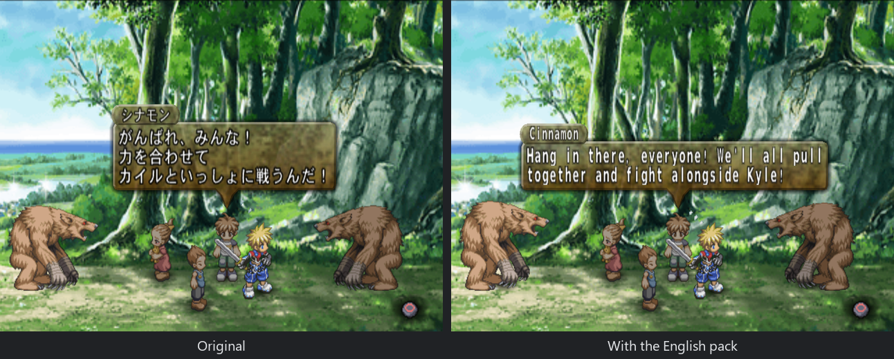
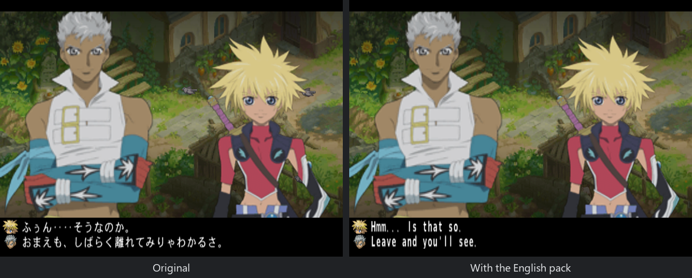
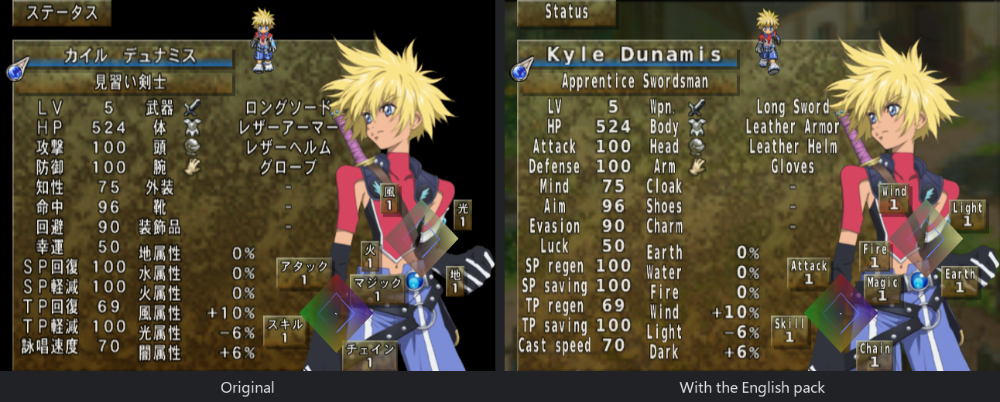
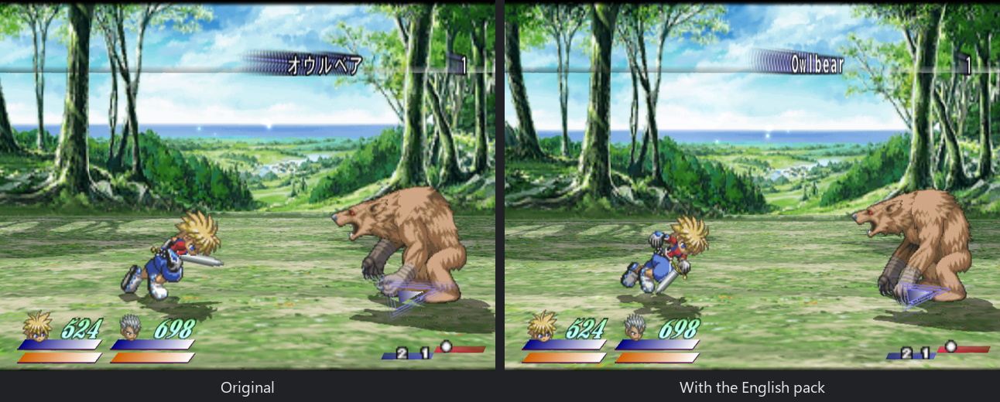
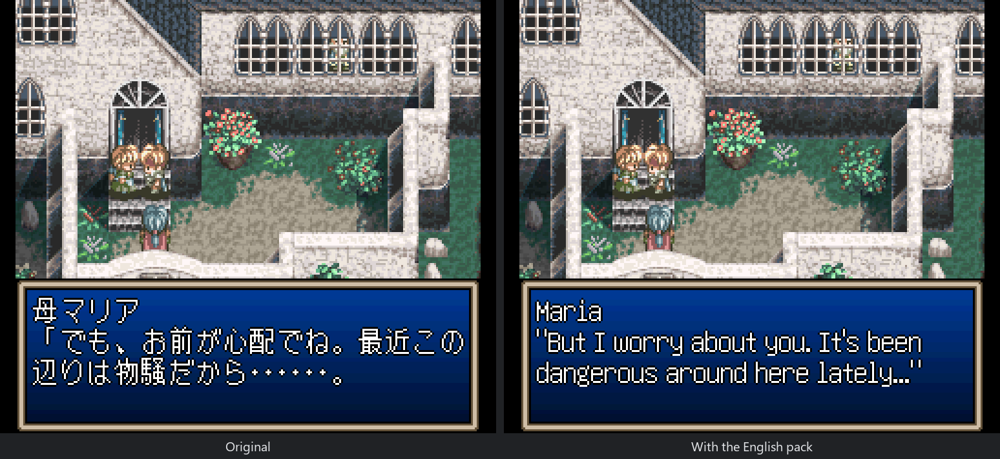
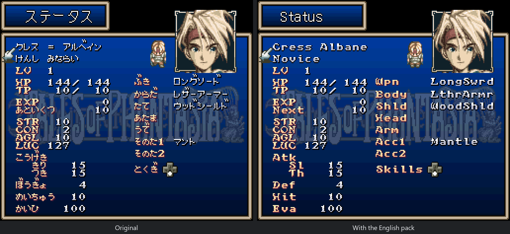
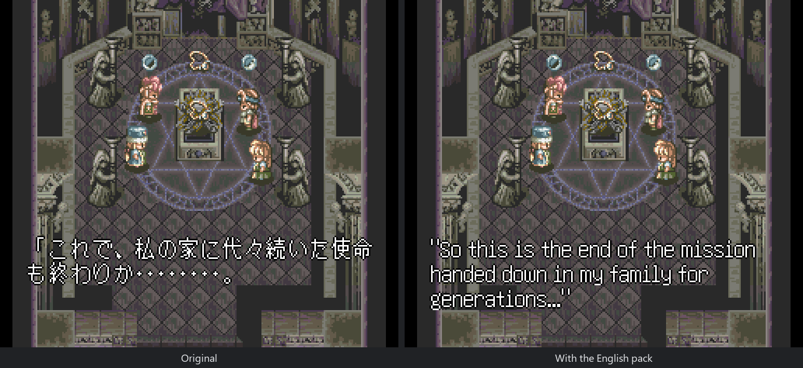

# ventris

A program that takes the text out of a game and puts a translation back in, in any alphabet.

The name is Michael Ventris's: the architect who deciphered Linear B in his spare time.

From the maker of [Interpreter](https://github.com/bquenin/interpreter), which translates the screen as
you play, for any game. The two are counterparts: where Interpreter shows a translation over the game,
ventris writes the translation into the game itself, for the games it has an adapter for.



Tales of Destiny 2 on the PlayStation 2: the original on the left, the game built with the English pack on
the right.

## How it works

The goal is to make translating a game easy for anyone, by handling the hard part: getting the script out
of the game and putting a translation back in. Translating is the easy part and plenty of people can do
it. Patching a SNES cartridge image or a PlayStation 2 disc image is not. So the work is split in two:

- **Adapter**: the code for one game, holding what has been reverse engineered about it (where the text
  lives, its encoding, pointers, compression, how text is drawn). Made once per game, by someone who took
  the game apart, and built into ventris: a new game arrives as a pull request.
- **Translation pack**: the script as plain text, one per language. This is all a translator touches, with
  the app and a text editor: no programming and no terminal. A pack holds no code and is not part of ventris:
  once a game has an adapter, anyone can write one.

How a new alphabet gets on screen depends on the game. Where the game draws text of one fixed width, a
variable-width renderer is injected (Tales of Phantasia); where its font has cells it does not use, new
glyphs are drawn into them and the game draws them as its own (Tales of Destiny 2). What is shared is
everything around that: preparing glyphs from a font, finding room for them, expanding the image, and
moving text that outgrew its place.

## What it looks like



Tales of Destiny 2: a skit, with each line beside the small face of the character who says it.



Tales of Destiny 2: Kyle's status screen, his name, title, equipment and labels in English, each label
fitted to the room the game gives it, such as `Wpn.` for the weapon.



Tales of Destiny 2: the first battle, where the enemy's name plate at the top is translated too.



Tales of Phantasia on the Super Famicom: a line of dialogue. The game draws its text at one fixed width; the
English is drawn variable-width, each letter as wide as it needs.



Tales of Phantasia: the status screen, its labels and item names fitted to the room the game gives them,
such as `Shld` and `LongSwrd`.



Tales of Phantasia: the opening scene, with its line of text over the picture in English.

Every picture has the original on the left and, on the right, the game built with the English pack from the
[packs repository](https://github.com/bquenin/ventris-packs), started from power-on. Those packs are machine
translated and have not been reviewed by a human translator yet.

## Where to start

- **You have a game and want to play it translated**: [Playing a translated game](docs/playing.md), with
  the app.
- **You want to fix a line, review a translation, or start one**: [Translating a game](docs/translating.md),
  with the app and a text editor. No programming and no terminal needed.
- **You want ventris to support a new game**: [Adding a game](docs/adding-a-game.md), with the command
  line.
- **You want to use ventris from a terminal or a script**: [Commands](docs/commands.md).

[CONTRIBUTING.md](CONTRIBUTING.md) has the ground rules and the checks a pull request passes.

Questions, a translation you would like in your language or would like help with, and taking a game apart
go to [Discussions](https://github.com/bquenin/ventris/discussions). Bugs and requests for a game go to
[Issues](https://github.com/bquenin/ventris/issues). A wrong line in a translation, and a pack you are
starting, go to the [packs repository's issues](https://github.com/bquenin/ventris-packs/issues), which has
a form for each.

## Games

It is early days: five games so far, one on the Super Famicom, one on the PlayStation, two on the
PlayStation 2 and one on the Nintendo DS.

| Game | Extract | Insert |
| --- | --- | --- |
| Tales of Phantasia (Super Famicom) | dialogue, menus and captions | dialogue, menus, captions and names, in any alphabet |
| Tales of Destiny 2 (PlayStation 2) | story scripts, skits, menus, battle and place names, the lists of skills, items, equipment, titles and recipes, the names of enemies, and the quiz and other games within the game | story scripts and skits, longer strings included, in any alphabet, with dialogue fitted to the speech bubble; the lists and the menus, whose changed strings share the room they had, so that one may be longer where others are shorter, and a menu may grow besides; the rest where it fits in the room of the game's own |
| Super Robot Wars Z (PlayStation 2) | stage dialogue, captions and objectives, battle lines, the names and help of the data lists, menus, the library, help and tutorial, summaries, credits, prologue, and the names of maps and squads | not yet |
| Ganbare Goemon: Tōkai Dōchū Ōedo Tengurigaeshi no Maki (Nintendo DS) | the scenes, what the townspeople and the shopkeepers say, the help, and the messages of the save and the wireless link | all of it, longer strings included, in any alphabet, with lines broken to the box; the storyteller's screens written across with an option |
| G.O.D pure (PlayStation) | dialogue, and the program's own text: shops, help pages, item, monster and place names, battle messages, menus, the bosses' speeches in battle | dialogue, longer strings included, in the Latin alphabet with characters the font lacks drawn into its free cells; the program's text not yet |

Each adapter was made for one release of its game, the Japanese one. The app shows each game's limits on
the game's page, and the command `ventris games` lists the same, with the release.

The packs are kept apart, in [ventris-packs](https://github.com/bquenin/ventris-packs): an English pack
of Tales of Phantasia and one of Tales of Destiny 2. They are working samples: they show that ventris
carries a whole game, from the dialogue to the menus and lists, and are playable as far as has been seen.
**Both are machine translated and have not been reviewed by a human translator yet**, and only parts of
each have been seen on screen. Anyone is free to improve them, or to write a pack of their own in any
language: [Translating a game](docs/translating.md) says how.

## No game files

Neither this repository nor the packs repository holds a game, a game's script, or any other file of a
game, and neither ever will. To play or to translate you need your own copy of the game. The program
reads it and writes a new file where you say. It never fetches a game.

The one thing the app fetches is the translation packs, which are text: each time it starts, it gets them
from the [packs repository](https://github.com/bquenin/ventris-packs) on GitHub and keeps a copy. It
contacts nothing else. The command-line program fetches nothing.

`roms/` and `work/` are ignored by git, along with the common cartridge, disc image and patch extensions.

## Scope

What ventris translates is what a game says. It does not turn the game into one made for another language.

In scope is the text an adapter can take out and put back, such as dialogue, menus, names and lists, along
with what it takes to draw a translation's alphabet and to give a longer string room.

Out of scope is changing the game beyond its text: a screen where the player enters a name from a grid of
the original's letters, boxes laid out again so that longer text fits, pictures with text drawn into them,
anything in how the game behaves. An adapter leaves those as the game has them, and what fits on screen is
up to a pack's author.

## Getting it

ventris is an app, for Windows, macOS and Linux, with an installer for each on the
[Releases page](https://github.com/bquenin/ventris/releases). It is all a player or a translator needs, with
a side for each and the same list of games on both: **Play a translation** gets the translation packs by
itself and builds a translated game; **Make a translation** saves a game's script to translate from, reads
and checks your pack, and builds the game from it to try it. No terminal and no programming. [Playing a translated game](docs/playing.md) and
[Translating a game](docs/translating.md) go through it.

For adapter authors and for scripts, the same page has a command-line program, `ventris`, over the same
engine. [Commands](docs/commands.md) describes it.

Both build the same game from the same pack, and the fonts they need are built in. Neither has been used
anywhere but Windows yet.

They are not signed with a certificate yet, so Windows and macOS warn the first time one is opened.
[First launch: security warnings](docs/playing.md#first-launch-security-warnings) says what to expect and
how to check a download.

To build the command-line program from source instead, install
[Rust](https://www.rust-lang.org/tools/install) (1.89 or later) and run, in a copy of this repository:

```bash
cargo build --release
```

which puts the program in `target/release/`.
[Building from source](docs/playing.md#building-from-source) says how to build the app.

## Layout

- `crates/ventris` is the engine, in Rust: the adapter contract (`src/adapter.rs`), one adapter per game
  in a folder of its own under `src/adapters/`, what is about a console under `src/platforms/`, the steps
  both programs share (`src/tasks.rs`), and the commands. It builds to the command-line program, fonts included.
- `app/` is a window over the same engine, for playing and translating: a web page in `app/src`
  (TypeScript and React) shown in a window by [Tauri](https://tauri.app/), and under `app/src-tauri` the
  Rust that page talks to, which calls the engine. It is a second program, `ventris-app`; see
  [Playing a translated game](docs/playing.md#the-app).
- `src/ventris_workbench` is the workbench, in Python: tools for taking a game apart. Nothing in it is
  needed to play or to translate a game; [Adding a game](docs/adding-a-game.md) describes it.
- `docs/` holds the guides, and [the pack format](docs/packs.md) in full.
- `tools/` holds what is run by hand now and then: drawing an outline font as a bitmap one, drawing the
  app's icon, and [the patch that adds automation to PCSX2](tools/pcsx2/README.md).

The engine was first written in Python and ported to Rust, held to building the same images byte for
byte. Comments in the engine that speak of "the Python reference" mean that first version.

## Development

```bash
cargo fmt --check
cargo clippy --all-targets -- -D warnings
cargo test
uv run ruff check
uv run ruff format --check
uv run pytest
```

Those check the engine and the workbench. The app is checked with the whole workspace, and its page from
`app/`:

```bash
cargo test --workspace
cargo clippy --workspace --all-targets -- -D warnings
cd app && npm test && npm run build
```

The tests that need a game look for it by what it is, not by a file's name: in the folder the environment
variable `VENTRIS_ROMS` names, or in `roms/` when it is not set. A test whose game is not there says so
and checks nothing. To set the variable for every `cargo` command on a machine, put it in
`.cargo/config.toml`, which is ignored; the one Python test that needs a game reads it from there too:

```toml
[env]
VENTRIS_ROMS = "C:/path/to/your/games"
```

The app fetches the packs from `https://github.com/bquenin/ventris-packs/archive/refs/heads/main.zip`
when it starts. To try it against packs served from your own computer, set the environment variable
`VENTRIS_PACKS_URL` to the address of a zip archive laid out as GitHub's, with the repository in one top
folder; `git archive --format=zip --prefix=ventris-packs-main/ HEAD` in the packs repository makes one.
The address must start with `https://`, or with `http://` for your own computer (`127.0.0.1`, `localhost`
or `[::1]`). Only the folders with a `pack.toml` in them are unpacked.
No test uses the network: the app's tests serve their archives from a server of their own.

## Licence

The engine, the app and the workbench are under the [MIT licence](LICENSE). The fonts built into the
program keep their own terms, which `ventris licenses` prints; they are listed in `crates/ventris/fonts`.
The packs have their own licence, stated in the packs repository.
